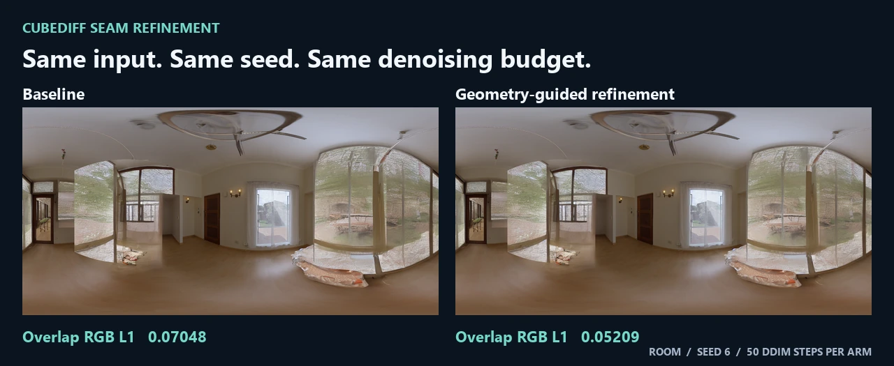
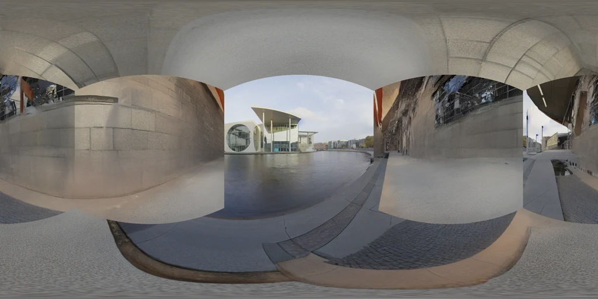

# CubeDiff Seam Refinement

**Geometry-guided latent updates for cubemap panorama generation.** Reduce disagreement between neighboring faces while keeping the pretrained model and denoising budget fixed.

面向 CubeDiff 全景生成的推理期接缝优化：固定模型权重与采样预算，通过几何对齐的跨面 latent 更新降低重叠区域误差。



*Actual room outputs, seed 6. The same conditioning image, prompt, checkpoint, and sampling budget were used for both arms. Images are resized for display; scores come from the untrimmed cube faces.*

[Results](#results) · [Quickstart](#quickstart) · [Method](#method) · [Limitations](#limitations) · [Research notes](research/README.md)

## Results

| Experiment | Coverage | Overlap RGB L1 reduction | Quality checks | Reference / baseline time |
| :--- | :--- | ---: | :---: | ---: |
| **Primary**, radius 0.25 | 4 scenes × 3 seeds, 24 generations | **22.38%** | 12/12 pairs | 0.974× |
| Radius 0.35 ablation | 4 scenes × 1 previously seen seed, 8 generations | 25.66% | 4/4 pairs | 0.985× |

Each generation used **50 DDIM steps and 100 UNet forwards**. The primary experiment reduced mean overlap RGB L1 from **0.08862 to 0.06879**, improving 142 of 144 scene/seed/edge observations. Quality checks measure condition and per-face content retention. The two rows have different seed coverage; the ablation does not replace the primary result. Timings are descriptive measurements on one Windows machine, not evidence of a speedup. See the [complete per-pair measurements](research/results.json).

## Quickstart

Use Python 3.12 and [CUDA-enabled PyTorch and torchvision](https://pytorch.org/get-started/locally/). The tested generation environment used PyTorch 2.11.0+cu128, torchvision 0.26, and an RTX 4050 Laptop GPU. The UNet runs on CUDA; the VAE and text encoder run on CPU.

```sh
python -m pip install -e ".[inference]"
python -m unittest discover -s checks -v
```

Obtain the [CubeDiff single-caption checkpoint](https://huggingface.co/hlicai/cubediff-512-singlecaption) at revision `04e7130c0a3806649d7f572db0e7ae8b6dd3a311` from its provider. Keep the snapshot files intact. The CLI runs offline and checks the [checkpoint fingerprints](cubediff_seams/checkpoint_sha256.json) before loading.

```sh
python -m cubediff_seams --checkpoint checkpoints/cubediff-512-singlecaption --image assets/room-condition.png --prompt "An indoor room with wooden flooring, windows and a lamp." --seed 6 --method refined --output runs/room-refined
```

Run again with `--method baseline --output runs/room-baseline` for the paired control. Use `--method expanded` for the radius 0.35 ablation. Output includes the six original 95° PNG faces, a 2048×1024 panorama, and `metrics.json`. Output directories must be new. The [case manifest](assets/cases.json) lists all four inputs and prompts.

You can independently measure existing 512×512 RGB faces without loading a model:

```sh
python -m cubediff_seams.measure --faces runs/room-refined --output runs/room-overlap.json
```

This command computes the raw overlap metric. The quality and timing results above come from the recorded research experiments; the standalone CLI does not reproduce that complete evaluation harness.

## Method

1. **Align rays.** Build a sparse graph of corresponding pixels in adjacent 95° cube faces, with bilinear reprojection and texture-aware weights.
2. **Refine locally.** During the final 15 DDIM steps, fit a bounded correction to the predicted clean latents. An analytic DDIM shadow that shares the current noise prediction limits accumulated edits. The conditioning latent and pixels outside graph support remain fixed by the update.
3. **Keep the sampling budget.** Convert the correction back to epsilon and use the original DDIM step. Graph updates use deterministic tensor operations in a scoped region; they add no UNet forward passes.

## Limitations

- This is a four-scene research prototype, based on the independent OpenCubeDiff implementation. It is not the official CubeDiff implementation or a paper reproduction.
- Shared-ray RGB L1 measures local overlap disagreement, excludes cube corners, and does not certify semantics or 3D consistency. The city example below still has visible roof/sky mismatches after refinement.
- The primary mean gain was **1.12×** the baseline seed-level standard deviation, below the predeclared **3×** diagnostic. The 22.38% reduction and the failed diagnostic are both retained.



*Known failure mode: city scene, seed 8, primary method. Lower overlap error can coexist with large structural seams.*

## Credits

- [CubeDiff paper](https://proceedings.iclr.cc/paper_files/paper/2025/hash/c9ef471a579197c4ed99df2aa542ce97-Abstract-Conference.html) and [OpenCubeDiff](https://github.com/Juan5713/OpenCubeDiff). Upstream software notice: [OpenCubeDiff MIT license](licenses/OpenCubeDiff-MIT.txt). No license is asserted here for the model weights, which are not included.
- The conditioning inputs are 95° perspective crops of [Poly Haven](https://polyhaven.com/) HDRIs under its [CC0 asset license](https://polyhaven.com/license). Individual sources are listed in [cases.json](assets/cases.json). The comparison and limitation figures use this project's generated outputs.
